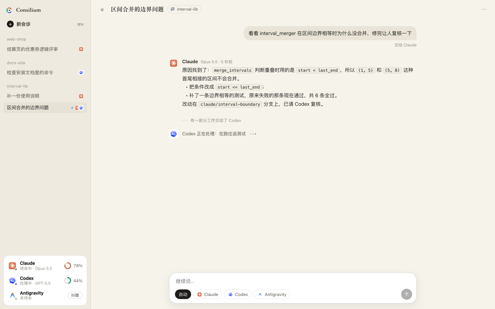
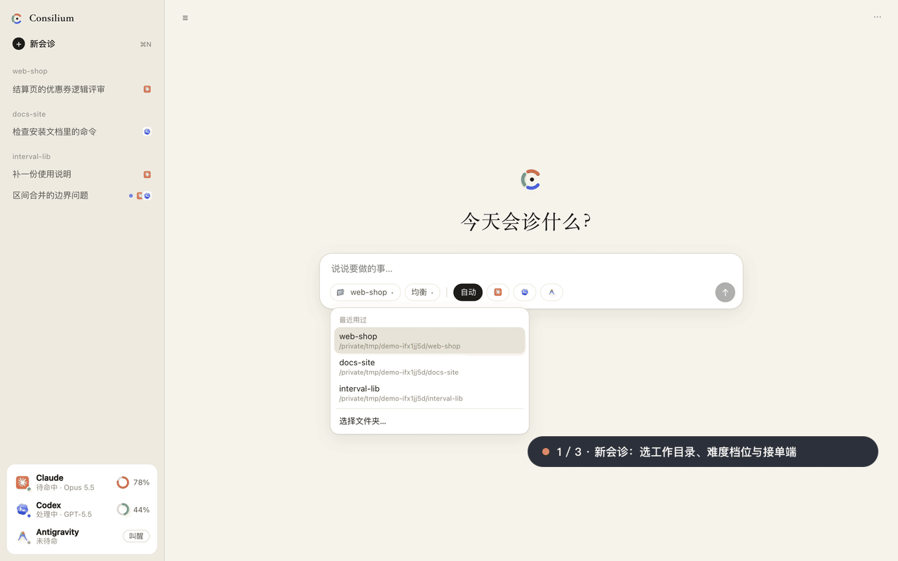
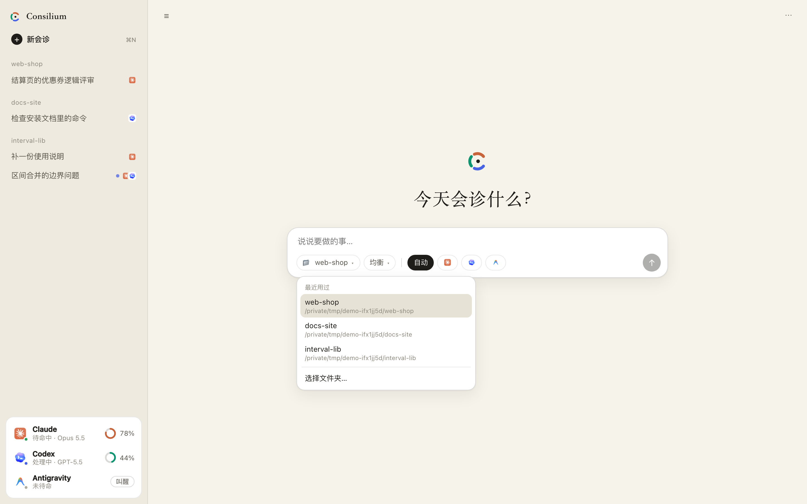
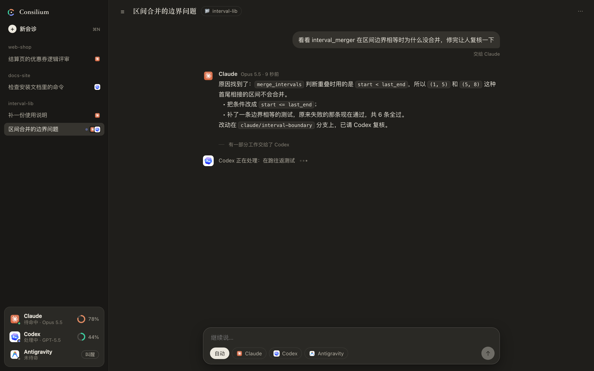
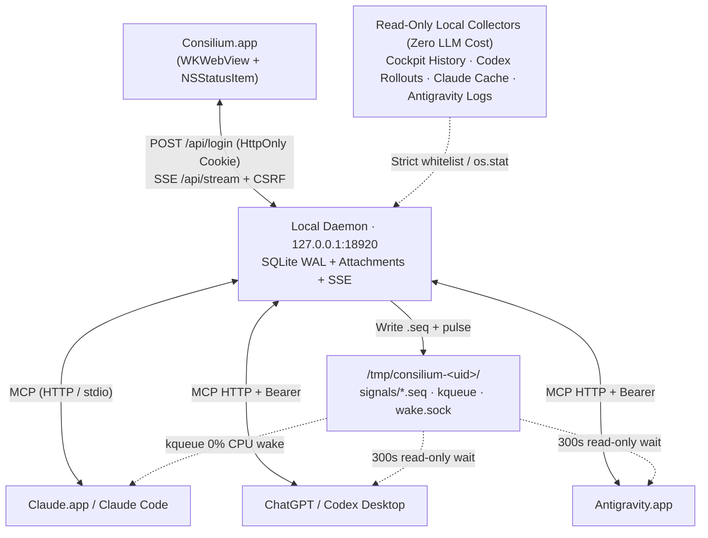

<div align="center">

<picture>
  <source media="(prefers-color-scheme: dark)" srcset="docs/brand/consilium-lockup-dark.svg">
  
</picture>

<h3>One window to orchestrate Claude, Codex, and Antigravity on your Mac</h3>

<p>
  <a href="README.md">简体中文</a> &nbsp;|&nbsp; <strong>English</strong>
</p>

<p>
  <a href="https://github.com/xiangshang2004/consilium/releases/latest"></a>
  <a href="#requirements"></a>
  <a href="#installation"></a>
  <a href="PRIVACY.md"></a>
  <a href="#development--repository-layout"></a>
  <a href="LICENSE"></a>
</p>

<p>
  <a href="#highlights">Highlights</a> ·
  <a href="#screenshots">Screenshots</a> ·
  <a href="#architecture">Architecture</a> ·
  <a href="#installation">Quickstart</a> ·
  <a href="docs/troubleshooting.md">Troubleshooting</a> ·
  <a href="PRIVACY.md">Privacy Policy</a> ·
  <a href="SECURITY.md">Security</a>
</p>

</div>

---

**Consilium** is a **100% local-first macOS app and MCP collaboration bus**. Type one message in its minimalist window, and Consilium routes work to the **native desktop apps already installed on your Mac** (**Claude**, **ChatGPT / Codex**, and **Antigravity**), gathering progress, file outputs, and final answers back into a single conversation.

> **No proxy APIs, no credential sharing, zero cloud relay**  
> Consilium never invokes model APIs directly or wraps CLI binaries: your tasks always run inside the official desktop apps using your own accounts and quotas. Pure Python 3.9+ standard library (`dependencies = []`) and zero external CDN assets.



---

## Highlights

<table>
  <tr>
    <td width="50%" valign="top">
      <strong>Unified Chat & Transparent Auto-Routing</strong><br>
      Mention specific peer(s) directly or pick <em>Auto</em>—Consilium chooses a standby coordinator with remaining quota headroom (skipping exhausted peers) and shows the routing rationale inline.
    </td>
    <td width="50%" valign="top">
      <strong>Zero-CPU Instant Wakeups</strong><br>
      Standby peers watch lightweight read-only signals via macOS <code>kqueue</code> (wake latency in tens of milliseconds). Offline peers receive non-focus-stealing notifications with verified deep links.
    </td>
  </tr>
  <tr>
    <td width="50%" valign="top">
      <strong>Folder-Scoped & Dedicated Sessions</strong><br>
      Pick your workspace via macOS <code>NSOpenPanel</code> when starting a session. Conversations stay grouped by folder and never bleed into other MCP sessions or projects.
    </td>
    <td width="50%" valign="top">
      <strong>Adaptive Reasoning Tiers</strong><br>
      Let receiving peers decide between <em>Fast</em>, <em>Balanced</em>, and <em>Deep</em> automatically (or pin one yourself), with reported model IDs, reasoning effort, and tier reasons surfaced per reply.
    </td>
  </tr>
  <tr>
    <td width="50%" valign="top">
      <strong>Local Quota Visibility & Handoffs</strong><br>
      Reads Cockpit Tools and local rate-limit caches strictly read-only to render remaining percentages, reset countdowns, and account pools—helping you hand off tasks manually before hitting limits.
    </td>
    <td width="50%" valign="top">
      <strong>Images, Slash Modes & Workspace Drawer</strong><br>
      Paste/drop PNG, JPEG, WebP, or GIF images (up to 20 MB); trigger <code>/plan</code>, <code>/goal</code>, <code>/agents</code>, and <code>/trace</code>; inspect tasks, files, and branches in a resizable 3-tab drawer; review or delete learned preferences anytime.
    </td>
  </tr>
</table>

---

## Screenshots



<table>
  <tr>
    <td width="50%">
      
    </td>
    <td width="50%">
      
    </td>
  </tr>
  <tr>
    <td align="center"><strong>New Conversation</strong> — Select workspace, tier, and peer(s)</td>
    <td align="center"><strong>Dark Mode</strong> — Follows macOS appearance automatically</td>
  </tr>
</table>

---

## Architecture



- **Truth Layer (`consilium/store.py`)**: SQLite WAL state with `attempt_id` fencing, orphan task reaper, scoped `consilium` vs `other` source isolation, and idempotent write receipts.
- **Doorbell (`consilium/wakeup.py`)**: `flock`-backed leases and `kqueue` VNODE watches keep standby listeners at 0% CPU without touching SQLite; cold fallback uses safe `osascript` notifications and verified `claude://code/new` & `codex://new?prompt=` deep links.

For full protocol invariants, see [docs/architecture.md](docs/architecture.md).

---

## Requirements

| Component | Requirement |
|---|---|
| **OS** | macOS 13 (Ventura) or newer; prebuilt **Apple Silicon (`arm64`)** binaries in Releases (Intel Macs can build from source) |
| **Toolchain** | Apple Command Line Tools (`xcode-select --install`, provides `/usr/bin/python3` 3.9+ and `swiftc`) — **no Xcode and no `pip` packages needed** |
| **Desktop Apps** | One or more of Claude, ChatGPT (Codex Desktop), and Antigravity |

---

## Installation

### 1. Get Consilium.app

Download `Consilium-<version>-arm64.dmg` (or `.zip`) from [Releases](https://github.com/xiangshang2004/consilium/releases/latest) and drag **Consilium.app** into `/Applications`.  
*(Builds are currently ad-hoc signed rather than Apple-notarized; on first launch, click **Open Anyway** in System Settings → Privacy & Security if prompted.)*

<details>
<summary>Or build from source in ~5 seconds</summary>

```bash
git clone https://github.com/xiangshang2004/consilium.git
cd consilium
./scripts/build_app.sh
cp -R build/Consilium.app /Applications/
```

</details>

### 2. Connect Your Desktop Apps (Dry-Run First)

```bash
# Preview every configuration edit without modifying any file
python3 scripts/install.py --dry-run --targets claude_code codex antigravity

# Apply changes with 0700/0600 timestamped backups
python3 scripts/install.py --apply --targets claude_code codex antigravity
```

Start a **new session** inside each desktop app so it loads the newly registered `consilium` MCP tools.

### 3. Launch & Wake Standby Peers

1. Open **Consilium.app** (the daemon starts and stops automatically with the app).
2. Opt in to task reminder notifications from **Consilium → 开启任务提醒…** in the menu bar if desired.
3. Click **叫醒 (Wake)** on any peer card in the lower-left dock to arm its standby session.

### Uninstall Completely

```bash
python3 scripts/install.py --uninstall --targets claude_code codex antigravity
rm -rf /Applications/Consilium.app \
       "$HOME/Library/Application Support/consilium" \
       "$HOME/Library/Logs/consilium" \
       "/tmp/consilium-$(id -u)"
```

Hit Gatekeeper prompts, missing MCP tools, port `18920` conflicts, or quota questions? See the **[Troubleshooting Guide (docs/troubleshooting.md)](docs/troubleshooting.md)**.

---

## Privacy & Security Summary

- **100% Local & Zero Telemetry**: Daemon binds strictly to `127.0.0.1`; `/ui` enforces `default-src 'none'` CSP with `Referrer-Policy: no-referrer` and `Cache-Control: no-store`; `Consilium.app` uses `WKWebsiteDataStore.nonPersistent()` and blocks external HTTP(S) navigation.
- **Hardened Loopback Auth**: Requires a 256-bit `auth.token` (`0600`), `HttpOnly; SameSite=Strict` cookies, exact `Origin` checks, `Content-Type` checks, `X-Consilium-CSRF` tokens, and strict HTTP/1.1 framing.
- **Read-Only Quota Isolation**: Reads only whitelisted Cockpit metadata and `mode=ro` history SQLite tables (`codex_accounts.sqlite` is **only** `os.stat()`ed by mtime and **never opened**), Codex rollout `rate_limits` tails, Claude quota cache, and local Antigravity transcript model IDs. Account display emails stay **strictly local to the UI** and are never sent to MCP tools or AI prompts.

Read the full **[Privacy Policy (PRIVACY.md)](PRIVACY.md)** and **[Security Policy (SECURITY.md)](SECURITY.md)**.

---

## Development & Repository Layout

```bash
# Full Python test suite (isolated mode)
env -u CLAUDE_CONFIG_DIR CONSILIUM_DRY_RUN=1 CONSILIUM_DISABLE_LOCAL_QUOTA_SYNC=1 \
  /usr/bin/python3 -B -m unittest discover -s tests -p 'test_*.py'

# Build and run two-case Consilium.app smoke test
./scripts/build_app.sh && ./scripts/smoke_test_app.sh
```

| Path | Contents |
|---|---|
| `consilium/` | Bus dispatcher, SQLite WAL store, `kqueue` wakeup, quota/model sync, offline UI |
| `app/macos/` | Native macOS menu bar & `WKWebView` Swift source and icons |
| `adapters/` | `consilium-collab` skill, Claude/Codex agent templates, `com.consilium.daemon.plist.tmpl` |
| `scripts/` | App builder, smoke test, atomic installer, GitHub release script |
| `tests/` | Unit and security/concurrency/UI regression tests |
| `docs/` | [Architecture](docs/architecture.md), brand SVGs, screenshots |

Contributions are welcome — see [CONTRIBUTING.md](CONTRIBUTING.md).

---

## License & Notices

- Original Consilium code and documentation are licensed under **CC BY-NC-SA 4.0** ([LICENSE](LICENSE)): free to share and adapt for non-commercial use with attribution and ShareAlike; commercial use requires written permission.
- Bundled OpenSpec agent skills remain MIT-licensed, and third-party desktop app icons remain the property of their respective owners; see [NOTICE](NOTICE).
