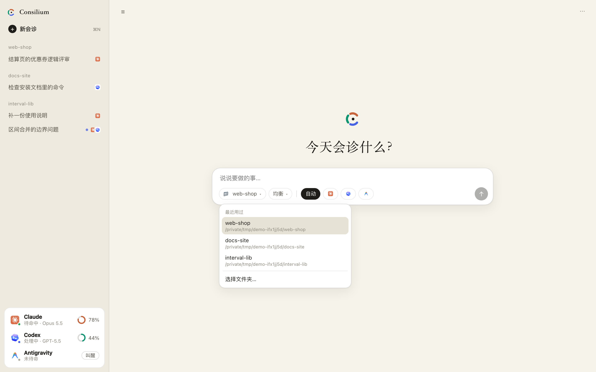
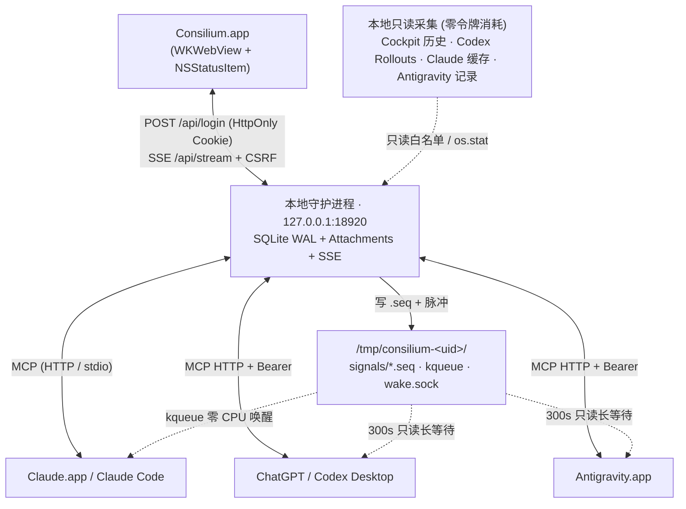

<div align="center">

<picture>
  <source media="(prefers-color-scheme: dark)" srcset="docs/brand/consilium-lockup-dark.svg">
  
</picture>

<h3>一个窗口，指挥你 Mac 上的 Claude、Codex 和 Antigravity</h3>

<p>
  <strong>简体中文</strong> &nbsp;|&nbsp; <a href="README.en.md">English</a>
</p>

<p>
  <a href="https://github.com/xiangshang2004/consilium/releases/latest"></a>
  <a href="#环境要求"></a>
  <a href="#安装与接入"></a>
  <a href="PRIVACY.md"></a>
  <a href="#开发与目录结构"></a>
  <a href="LICENSE"></a>
</p>

<p>
  <a href="#核心能力">核心能力</a> ·
  <a href="#界面预览">界面预览</a> ·
  <a href="#工作原理">工作原理</a> ·
  <a href="#安装与接入">快速开始</a> ·
  <a href="#使用指南">使用指南</a> ·
  <a href="PRIVACY.md">隐私协议</a> ·
  <a href="SECURITY.md">安全说明</a>
</p>

</div>

---

**Consilium**（拉丁语“会诊、议事会”）是一个 **100% 本机运行的 macOS 应用与协作总线**。你在它的单一窗口里像平时聊天一样说一句话，Consilium 会把任务交给你 Mac 上**已经装好的三个官方桌面应用**（**Claude**、**ChatGPT / Codex**、**Antigravity**）去完成，并把三家的过程摘要、文件产物与最终答复汇合回同一个会诊界面。

> **无代理费用、无密钥托管、零云端中转**  
> Consilium 自己不调用任何大模型 API，也不包装 CLI；干活的始终是你桌面应用里自己的账号和额度。后端零第三方 `pip` 依赖，前端零外部 CDN 资源。


---

## 核心能力

<table>
  <tr>
    <td width="50%" valign="top">
      <strong>统一会诊与自动分配</strong><br>
      支持点名某一家或多家协同，也可选「自动」：由 Consilium 结合待命状态、历史习惯与当前余量挑选协调者，并在消息下方写明分配理由；额度耗尽端不参与重任务分派。
    </td>
    <td width="50%" valign="top">
      <strong>零轮询即时叫醒</strong><br>
      三端各自保持轻量级只读 <code>kqueue</code> 门铃待命，消息一到零点几秒响应；无人待命时发送仅提示不抢焦的系统通知，点开通知可通过官方深链或剪贴板快速取件。
    </td>
  </tr>
  <tr>
    <td width="50%" valign="top">
      <strong>按文件夹分组，绑定专属会话</strong><br>
      新会诊时通过系统 <code>NSOpenPanel</code> 或最近记录选定工作目录，侧边栏自动按目录聚合；支持在各应用为重要会诊绑定延续上下文的专属原生会话。
    </td>
    <td width="50%" valign="top">
      <strong>自动判断难度档位</strong><br>
      无需每次手动挑模型，接收端按「快 / 均衡 / 深度」自行判断或使用指定档位执行，并在回复中明示实际所用模型、推理强度与档位理由。
    </td>
  </tr>
  <tr>
    <td width="50%" valign="top">
      <strong>本地额度余量感知与交接</strong><br>
      只读读取 Cockpit Tools 与本地速率缓存，顶栏与左下角卡片直观展示三端余量、重置倒计时与历史账号池；余量偏低时可带上下文交接给另一端（切号仍由你手动完成）。
    </td>
    <td width="50%" valign="top">
      <strong>习惯沉淀、图文与三页右栏</strong><br>
      支持直接粘贴/拖拽 PNG、JPEG、WebP、GIF 截图（单张 ≤ 20 MB）；用 <code>/plan</code>、<code>/goal</code>、<code>/agents</code>、<code>/trace</code> 触发协作模式；可拖拽右栏集中查看任务、文件与分支；学会的偏好每条可见、随时可删。
    </td>
  </tr>
</table>

---

## 界面预览

<table>
  <tr>
    <td width="50%">
      
    </td>
    <td width="50%">
      
    </td>
  </tr>
  <tr>
    <td align="center"><strong>新会诊</strong> — 选定工作目录、难度档位与接单端（或自动）</td>
    <td align="center"><strong>深色模式</strong> — 纸墨配色适配系统浅/深色外观</td>
  </tr>
</table>

---

## 工作原理



- **本地总线（SQLite WAL）**：保存会诊、消息、任务租约（`attempt_id` 围栏防过期覆盖）、事件流与幂等请求键（断线原样重试不重复建单）。
- **门铃机制（`kqueue` + `.seq`）**：有新工作时写信号文件并按来源隔离（`scope="consilium"`），Consilium 会诊与其它项目的 MCP 会话**互不串线**。
- **冷通知回退**：无人待命时可选弹系统通知；点击通知时对 Claude / Codex 唤起已核实的 `claude://code/new` 与 `codex://new?prompt=` 深链，Antigravity 复制取件指令并切回 Consilium。

更深入的协议与不变量设计请参阅 [docs/architecture.md](docs/architecture.md)。

---

## 环境要求

| 组件 | 要求 |
|---|---|
| **系统** | macOS 13 (Ventura) 或更新版本；Releases 提供 **Apple Silicon (`arm64`)** 预编译包，Intel Mac 可从源码编译 |
| **系统工具** | Apple Command Line Tools（系统自带 `/usr/bin/python3` 3.9+ 与 `swiftc`）：`xcode-select --install`；**无需 Xcode，无需 `pip install`** |
| **桌面应用** | 已安装 Claude、ChatGPT (Codex)、Antigravity 中的任意一个或多个官方桌面应用 |

---

## 安装与接入

### 第 1 步：获取 Consilium.app

- **推荐**：前往 [Releases](https://github.com/xiangshang2004/consilium/releases/latest) 下载最新的 `Consilium-<版本>-arm64.dmg`（或 `.zip`）及对应 `.sha256` 校验文件，将 `Consilium.app` 拖入「应用程序」。
  > **提示**：预编译包目前使用本地 ad-hoc 签名（无 Apple 公证），首次打开若受 Gatekeeper 拦截，请在「系统设置 → 隐私与安全性」点击 **仍要打开**。

<details>
<summary>或从源码零依赖构建（约 5 秒完成）</summary>

```bash
git clone https://github.com/xiangshang2004/consilium.git
cd consilium
./scripts/build_app.sh
cp -R build/Consilium.app /Applications/
```

</details>

### 第 2 步：连接桌面应用（仅在你确认后写入）

先以只读演练（`--dry-run`）预览将要改动的文件，确认无误再应用：

```bash
# 预览接入计划（不改动任何文件）
python3 scripts/install.py --dry-run --targets claude_code codex antigravity

# 写入本地 MCP 与 consilium-collab 技能（自动保留 0700/0600 时间戳备份）
python3 scripts/install.py --apply --targets claude_code codex antigravity
```

- 只用其中一两家时，仅保留对应 target（可选目标：`claude_code`、`codex`、`antigravity`、`claude_desktop`、`claude_agents`、`codex_agents`、`launchd`）。
- 三个桌面应用只在**新开的会话**里才会加载新接入的 `consilium` 工具，已开着的旧会话需重开。

### 第 3 步：启动 Consilium 并开启待命

1. 打开 **Consilium.app**（后台服务随应用自动启动与退出）。
2. 若希望离开窗口时收到系统提醒，点击顶部菜单栏「Consilium → **开启任务提醒…**」按需授权。
3. 点击左下角卡片里的 **「叫醒」**，即可让对应桌面应用开启只读待命会话。

### 完整卸载与清理

```bash
# 1. 移除由安装器写入的受管配置条目
python3 scripts/install.py --uninstall --targets claude_code codex antigravity

# 2. 清理 App、本机状态库、日志与临时门铃目录
rm -rf /Applications/Consilium.app \
       "$HOME/Library/Application Support/consilium" \
       "$HOME/Library/Logs/consilium" \
       "/tmp/consilium-$(id -u)"
```

---

## 使用指南

- **新建与发消息**：按 `⌘N` 新开会诊 → 选择工作目录（支持新建目录）→ 选定「自动」或点名发送；支持粘贴/拖入截图，可同时保留多个草稿。
- **快捷指令 (`/`)**：在输入框键入 `/` 可快速选择 `/plan`、`/goal`、`/agents <数量>`（请求接收端内部启动原生子代理）、`/trace`（上报阶段证据摘要）、`/export`（导出 Markdown）或各端专属会话入口。
- **右侧工作区与改名**：右上角按钮或 `⌘\` 开合右侧「任务 / 文件 / 分支」三栏（左边缘可拖宽）；点击顶部标题或「改名」编辑标题（回车/失焦保存，Esc 取消）；鼠标悬停左侧会诊条目可一键归档（只收起 Consilium 展示，不影响各应用原会话）。
- **接入 Cockpit Tools 查看额度**：
  1. 在同 macOS 用户下安装并打开 [Cockpit Tools](https://github.com/jlcodes99/cockpit-tools/releases)，登录并刷新 Codex / Antigravity 账号。
  2. Consilium 自动只读 `~/.antigravity_cockpit/` 历史记录，并在左下角卡片、顶栏与 `/accounts` 设置中展示当前账号余量与重置倒计时；若记录过久会标注采样时间或提示待同步。Claude 无 Cockpit 额度时，Consilium 会继续读取可用的 `~/.claude/` 本地用量缓存。

---

## 隐私与安全

我们把隐私边界写进了代码和 [`PRIVACY.md`](PRIVACY.md) 协议中，核心承诺如下：

| 维度 | 实现保障 |
|---|---|
| **零遥测、零外连** | 纯本机运行，daemon 仅绑定 `127.0.0.1`；`/ui` 实行 `default-src 'none'` 严格离线 CSP、`Referrer-Policy: no-referrer` 与 `Cache-Control: no-store`；`Consilium.app` 使用 `WKWebsiteDataStore.nonPersistent()` 并拦截非本机网页。 |
| **认证与防护** | API/MCP 强制 `0600` 256 位 `auth.token`（拒绝 URL `?token=` 传参，支持 `consilium rotate-token` 轮换）；Cookie 写操作同时校验 `HttpOnly`、`SameSite=Strict`、精确 `Origin`、`Content-Type` 与 `X-Consilium-CSRF`；单张图片限制 ≤ 20 MB 并校验文件魔数与防符号链接目录权限。 |
| **本机只读最小白名单** | 仅读取 Cockpit 工具白名单元数据与 `mode=ro` 历史数据库、Codex 会话日志末尾 128 KB 里的 `rate_limits`、Claude 本地用量缓存及 Antigravity 日志中匹配当前 `attempt_id` 的模型标识；**绝不打开 `codex_accounts.sqlite` 或任何加密凭证库**。 |
| **账号隐私本机隔离** | 上游账号标识在入库时即 SHA-256 哈希为 `acct-<10-hex>`；`quota_account_names`（登录邮箱/展示名）**只在本机界面显示，永不通过 MCP 或提示词发送给三大桌面 AI**。 |

完整数据清单、第三方桌面应用（Anthropic / OpenAI / Google）边界说明与删除方式，请参阅 **[隐私协议（PRIVACY.md）](PRIVACY.md)** 与 **[安全政策（SECURITY.md）](SECURITY.md)**。

---

## 已知边界

- 仅针对 **macOS 桌面端** 设计与验证（最低 macOS 13）。
- Consilium 不能从外部代各桌面应用切换底层主模型；模型与推理强度遵循各应用内部设置，由其执行后如实上报。
- Claude Desktop 不允许被自动后台唤醒轮次擅自拉起新会话，因此默认由待命会话携带上下文处理；需独立连续会话时，可通过顶部 `⋯` 一键开启并绑定当前会诊。

---

## 开发与目录结构

全套工程零第三方依赖（Python 3.9+ 标准库 + CLT `swiftc`）：

```bash
# 运行全套单元测试（隔离模式 / 本地同步模式）
env -u CLAUDE_CONFIG_DIR CONSILIUM_DRY_RUN=1 CONSILIUM_DISABLE_LOCAL_QUOTA_SYNC=1 \
  /usr/bin/python3 -B -m unittest discover -s tests -p 'test_*.py'

# 构建与双场景冒烟测试
./scripts/build_app.sh && ./scripts/smoke_test_app.sh

# 独立启动服务或查看状态
python3 -m consilium.cli serve
python3 -m consilium.cli status
```

| 目录 / 文件 | 说明 |
|---|---|
| `consilium/` | 协作总线、SQLite 存储、kqueue 门铃、额度与模型提取、离线 UI |
| `app/macos/` | `Consilium.app` 原生菜单栏与窗口 Swift 源码及图标资源 |
| `adapters/` | 三端协作技能 `consilium-collab`、Claude/Codex 子代理与 `launchd` 模板 |
| `scripts/` | App 构建、冒烟测试、双阶段安装器与版本发布脚本 |
| `tests/` | 单元测试与安全性/并发/UI 回归测试 |
| `openspec/` & `reviews/` | OpenSpec 契约规范与多端交叉审查归档 |
| `docs/` | 架构详解（[docs/architecture.md](docs/architecture.md)）、品牌 SVG 与截图 |

欢迎阅读 [CONTRIBUTING.md](CONTRIBUTING.md) 参与改进！

---

## 许可与权属

- Consilium 原创代码与文档基于 **CC BY-NC-SA 4.0** 协议开源：非商业用途可自由复制、修改与分享（须保留署名、附许可链接并保持相同方式共享）；商业使用须另获权利人书面许可。全文见 [LICENSE](LICENSE)。
- 仓库内附带的 OpenSpec 工具模板遵循其 MIT 声明，三方桌面应用图标及商标归各自权利人所有。详见 [NOTICE](NOTICE)。
