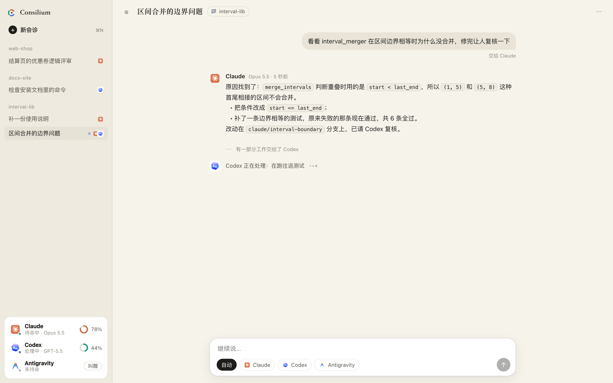
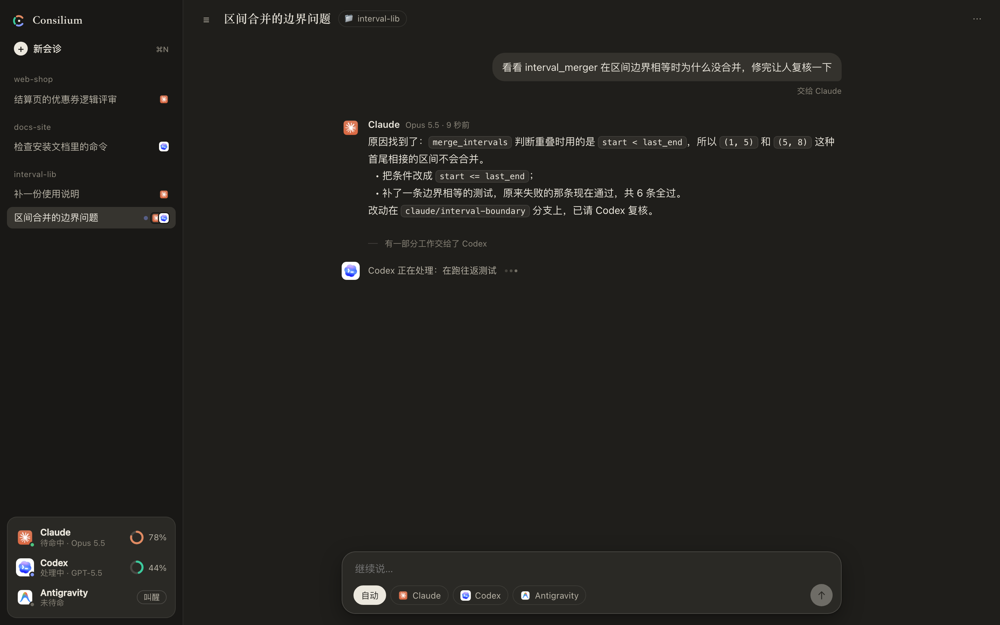

<p align="center">
  <picture>
    <source media="(prefers-color-scheme: dark)" srcset="docs/brand/consilium-lockup-dark.svg">
    
  </picture>
</p>

<p align="center">一个窗口，指挥你 Mac 上的 Claude、Codex 和 Antigravity。</p>

---

Consilium 是一个本地的 macOS 应用。你在它的窗口里说一句话，它把这句话交给你电脑上已经装好的三个官方桌面应用（Claude、ChatGPT/Codex、Antigravity）去做，三家的回复都回到同一个窗口。

它自己不调用任何模型接口，也不包装命令行工具：干活的始终是那三个应用里你自己的账号和额度。



## 能做什么

- **在一个窗口里发消息。** 可以点名发给某一家或几家，也可以选“自动”，由 Consilium 挑一家当协调者，协调者决定自己做还是拆给别人，最后把结果汇总给你。
- **档位自动定。** 不用你选模型和推理强度：处理的一端按难度自己定“快 / 均衡 / 深度”并照做，回复前面写明用了哪一档、为什么。想自己定时，输入框旁边随时可以改。
- **自动分配看得见理由。** 选“自动”时，你那条消息下面会写明交给了谁、为什么：优先选正在待命、当前账号余量充足的一家，余量耗尽的不选。
- **待命，零点几秒送达。** 三家都可以开一个待命会话，消息一到就被叫醒。没有待命的一家会收到系统通知，点一下就能在对应应用里打开。
- **按文件夹工作。** 新会诊时从“最近用过”里选文件夹，或用系统窗口选。文件夹在会诊开始后固定，侧边栏按文件夹分组。
- **记住你的习惯。** 某一家看出你稳定的偏好（例如“代码审查都给 Codex”）会记成一条偏好，以后自动分配时参考。每一条都看得见、删得掉。
- **额度不够时交接。** 某一家的额度快用完时，可以把任务连同进度说明交给另一家。切换账号始终由你手动完成。
- **账号和余量一眼看到。** 左下角的卡片显示三家各自的状态、最近用的模型和推理强度、当前账号的余量。余量直接读 Cockpit Tools 本地的额度记录，不用各家自己去查；记录不是刚刷新的时会标明是多久前的。
- **互不串线。** 窗口里只列出你在 Consilium 里发起的会诊。别的项目里的会话如果自己用了这条总线，不会出现在这里；归档只是在 Consilium 里收起，不动三个应用里的会话。
- **全部在本机。** 数据在本机的 SQLite 里，服务只监听 `127.0.0.1`，界面不加载任何外部资源。

<table>
  <tr>
    <td></td>
    <td></td>
  </tr>
  <tr>
    <td align="center">新会诊：选文件夹、档位和发给谁</td>
    <td align="center">深色模式</td>
  </tr>
</table>

## 它是怎么工作的

```text
        你在 Consilium 窗口里说一句话
                     │
                     ▼
      ┌──────────────────────────────┐
      │  Consilium.app（本机服务）      │   SQLite 记录会诊、任务和事件
      │  127.0.0.1:18920              │   门铃：文件信号 + kqueue，不轮询
      └──────────────┬───────────────┘
                     │  MCP（每个应用里装一个 consilium 连接）
        ┌────────────┼────────────┐
        ▼            ▼            ▼
     Claude        Codex      Antigravity
   （官方桌面应用，用你自己的账号和额度）
```

- **总线**：一个本地服务，提供 17 个 MCP 工具（建会诊、派任务、取件、汇报进度、交付、交接、记偏好、查额度等）。三个应用通过各自的 MCP 配置连上它。
- **门铃**：有任务时写一个信号文件，待命会话靠 kqueue 被叫醒，空等时不花额度（Codex 和 Antigravity 的待命是 5 分钟一轮的长等待，会用掉少量额度）。
- **没人待命时**：发系统通知，并提供 `claude://`、`codex://` 深链，点一下在对应应用里新开会话并预填“去取消息”。
- **协作技能**：安装时会给三个应用各放一份 `consilium-collab` 技能，告诉它们怎么取件、怎么回复、怎么交接。

更细的设计见 [docs/architecture.md](docs/architecture.md)。

## 需要什么

- macOS 13 或更新。Releases 里的压缩包是 Apple 芯片版；Intel 机器可以自己构建，但没有测过。
- Command Line Tools（提供 `/usr/bin/python3` 和 `swiftc`）：`xcode-select --install`。不需要完整的 Xcode，也不需要任何 pip 包。
- 三个桌面应用里至少装了一个：Claude、ChatGPT（Codex）、Antigravity。

## 安装

**1. 拿到应用。** 从 [Releases](../../releases) 下载 `Consilium-<版本>-arm64.zip`，解压后拖进“应用程序”。应用没有做公证，第一次打开要在“系统设置 → 隐私与安全性”里点“仍要打开”。

也可以自己构建：

```bash
git clone https://github.com/xiangshang2004/consilium.git
cd consilium
./scripts/build_app.sh
cp -R build/Consilium.app /Applications/
```

**2. 把三个应用连上。** 先看一遍会改哪些文件，再执行：

```bash
python3 scripts/install.py --dry-run --targets claude_code codex antigravity
python3 scripts/install.py --apply --targets claude_code codex antigravity
```

安装脚本会给每个被改的配置文件留带时间戳的备份。只想连其中一两家，就只写对应的目标。

**3. 打开 Consilium。** 后台服务随应用一起启动、一起退出，没有开机自启。

三个应用都只在**新开的会话**里才看得到新装的 consilium 工具，已经开着的会话要重开一次。

### 卸载

```bash
python3 scripts/install.py --uninstall --targets claude_code codex antigravity
```

然后把 Consilium.app 拖进废纸篓。会诊记录在 `~/Library/Application Support/consilium/`，要一并清掉就删这个目录。

## 使用

1. 按 ⌘N 新开会诊，选文件夹，选发给谁，说要做的事。档位默认自动，想指定时点“档位”。
2. 第一次用时，左下角卡片里没在待命的一家旁边有“叫醒”按钮：点一下会在那个应用里新开一个待命会话，你按一次发送就行（Antigravity 没有深链，会复制一段指令让你粘贴）。
3. 回复出现在对话里，带着是哪一家、用的什么模型。继续在同一个会诊里输入就是追问，处理的一家会先读这个会诊之前的对话。
4. 鼠标移到左侧某个会诊上，右边出现归档按钮；归档的会诊收进列表底部的“已归档”。
5. 右上角的图标打开右侧栏，看这个会诊的任务、文件和分支；拖左边缘调宽度，⌘\ 关闭。
6. 点标题可以改名；右上角“⋯”里有“在 Claude 里开专属会话”、主题切换，以及“模型与账号”“偏好”两项设置。

## 安全与隐私

- 服务只监听 `127.0.0.1`。MCP 请求要带本机的访问令牌（`auth.token`，权限 0600）；浏览器端用随机会话，写操作要同源、JSON 和 CSRF 令牌三样齐全。
- 界面完全离线：内容安全策略是 `default-src 'none'`，页面里没有任何外部链接或脚本。
- 应用只会打开 `claude://code/new` 和 `codex://new` 两种深链。
- 读 Cockpit Tools 的数据时只读额度记录和“当前是哪个账号”的指针，不打开它的账号库、密钥和加密文件；账号标识在 Consilium 里以哈希保存。
- 安装脚本默认只演示（`--dry-run`），`--apply` 才会写入，并且每个文件都留备份；Claude 桌面应用在运行时不会改它的配置。

## 目前的限制

- 只支持 macOS 的桌面使用，不做手机适配。
- Consilium 自己不能替三个应用切换模型。档位靠各应用里的会话自己执行（例如把难的任务交给更高推理强度的子代理），做没做到以它上报的模型、effort 和档位为准。
- Claude 桌面应用不允许被自动事件叫醒的那一轮自己开新会话，所以默认由待命会话直接处理；需要专属会话时由你点一下来开。
- Cockpit Tools 目前不记录 Claude 的余量，所以 Claude 的余量圆环是空的，不会猜一个数字。
- 待命会话可能被别的项目的门铃叫醒一次，它取不到东西就会回去继续等。

## 开发

纯 Python 标准库（3.9 以上），没有第三方依赖。应用外壳是 Swift，用 Command Line Tools 自带的 `swiftc` 编译。

```bash
# 全部测试
env -u CLAUDE_CONFIG_DIR CONSILIUM_DRY_RUN=1 CONSILIUM_DISABLE_LOCAL_QUOTA_SYNC=1 \
  /usr/bin/python3 -B -m unittest discover -s tests

# 构建应用并冒烟测试
./scripts/build_app.sh && ./scripts/smoke_test_app.sh

# 不开应用，直接起服务或看状态
python3 -m consilium.cli serve
python3 -m consilium.cli status
```

| 目录 | 内容 |
|---|---|
| `consilium/` | 总线、存储、门铃、额度、界面（单个离线网页） |
| `app/macos/` | Consilium.app 的 Swift 源码 |
| `adapters/` | 三个应用用的协作技能和子代理模板 |
| `scripts/` | 构建、冒烟测试、安装、发布 |
| `tests/` | 单元和回归测试 |
| `openspec/` | 需求和设计记录 |
| `reviews/` | 每一轮的评审和交接记录（R001 起） |
| `docs/` | 架构说明、标志、截图 |

## 版本与发布

用 GitHub Releases 迭代，版本号按 `主.次.修` 三段：改了使用方式或数据格式升“次”，只修问题升“修”。每个版本的变化写在 [CHANGELOG.md](CHANGELOG.md)。

发一个新版本：

1. 在 `CHANGELOG.md` 顶部写好这个版本的条目。
2. 运行 `./scripts/release.sh 0.2.0`。它会改三处版本号、跑全部测试、构建并冒烟测试应用、打包、提交、打标签 `v0.2.0`、推送，并用这一版的更新说明创建 Release，附上应用压缩包和校验值。

加 `--dry-run` 只做检查和打包，不提交、不推送、不建 Release。
