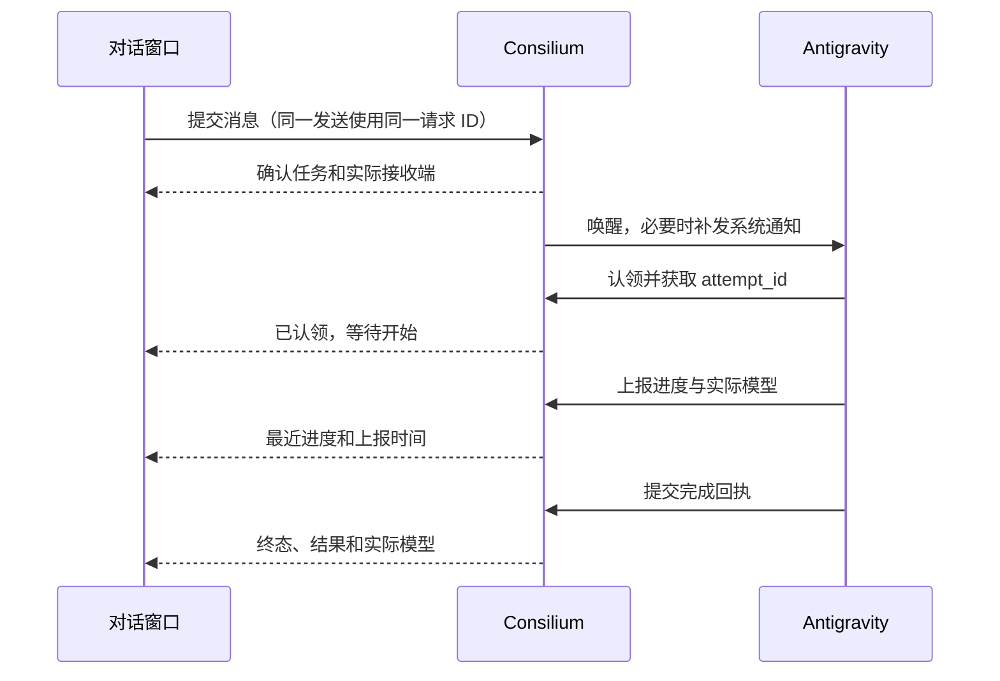

# 会诊状态同步与对话窗口设计

## 复现记录

| 本次观察 | 窗口应表达 |
| --- | --- |
| 换号后 Cockpit 报告当前账号余量 42% | 新账号额度已同步，单独显示待命连接 |
| 测试消息热唤醒无回执，随后发出系统通知 | 系统通知已发，等待 Antigravity 认领 |
| 旧型号任务最后在 22:52 上报，仍无完成回执 | 已上报进度和时间。租约未过期时显示「等完成回执」 |
| Codex 已交付型号功能并发布到 v0.6.0 | 关联实际交付。协调者可收尾重复的 Antigravity 尝试 |
| 追问走当前会诊的「自动」，实际派给 Codex | 在用户消息下记录「自动交给 Codex · 当前会诊协调者」 |

当前的 `renderPending` 将已认领和执行中渲染成同一句「正在处理」。投递记录的 `delivery_mode` 在补发通知时也会改为冷通知，窗口难以同时看见两步。SSE 当前只比较计数，`EventHub` 重启后从零开始，旧网页有条件把新实例的前几次更新丢弃。三处问题分别有独立证据和验收，时序见下文。

## 状态投影

| 层 | 权威记录 | 对话窗口中的表达 |
| --- | --- | --- |
| 发送 | 服务端提交消息、任务和目标；重试关联同一发送请求 | 提交前显示「发送中」。提交后显示实际目标和分配原因 |
| 投递 | 门铃信号、补发通知、确认时间，按事件保留 | 「已唤醒 · 待认领」或「系统通知已发 · 待认领」。投递失败显示具体错误 |
| 任务 | 任务状态、有效 `attempt_id`、领取时间、最新进度时间、结果 | 「已认领 · 等开始」「已上报进度」「进度过期」「已完成」等 |
| 待命 | 现有活跃监听及其已观测的在线信息 | 「待命」「未在待命」。只用于新任务是否可唤醒 |
| 额度 | Cockpit 当前账号及匹配样本、观测时间、耗尽窗口 | 账户余量和恢复建议。换号后等匹配新账号的样本 |
| 窗口连接 | SSE 会话及整份快照的连接状态 | 「同步中」「正在重连 · 显示上次状态」「轮询更新」 |

后端以一个状态投影给聊天卡片和任务侧栏供数，返回事实、时间和可恢复动作，前端共用状态组件与本地化文案。默认显示最有行动价值的一行，展开后显示时间线。额度作为原因提示附在任务旁，任务的执行结果继续由任务租约和回执决定。

### 任务与投递时序

对尚未认领的任务，记录热唤醒与冷通知结果及时间，ACK 和认领分别来自原有数据库提交。只收到 ACK 时仍展示「待认领」。重试通知沿用原任务与投递链，重试执行沿用原任务、签发新 `attempt_id`。执行过期沿用现有服务端租约配置和 reaper 事件，窗口即时展示上次进度时间。失败来自应用回执、投递异常或权威过期事件。进入终态后，迟到的旧 attempt 上报继续拒绝。

### 换号和重复任务

换号期间按 Cockpit 观测到的当前账号或疑似切号标记，显示「等新账号额度同步」。只有匹配当前账号的新样本才把新余量填入窗口。同一账号的窗口重置时间沿用 Cockpit 事实。切换成功时提示当前端与新余量，可确认收起。换号更新额度卡片；队列任务保留原 ID，认领和恢复仍等待执行端。

协调者可通过事务收尾一项已由其他任务交付的重复尝试。操作指定原任务、当前 attempt、已完成交付的关联 ID 与原因。使用现有 `cancelled` 终态并记录「已由其他任务交付」，保留旧进度、模型、物证和关联结果。操作前展示关联交付和影响。跨工作区选错交付、attempt 已变化，或任务已完成时拒绝写入并提示刷新。避免重复关闭整条会诊或误终止仍有独立工作价值的分支。

### 页面恢复与一致性

1. 服务每次启动创建一个 `instance_id`，随 `/api/state` 和 SSE 快照返回。同一实例的 `state_version` 单调比较，重复和更早版本保持幂等。
2. 连接断开时标记上次状态的时间。首次连入新实例要重新接受全量快照并建立新的版本基线；丢弃来自旧连接或上一轮 fetch 的迟到帧。
3. 保留本地输入草稿、选中会诊和当前焦点。SSE 更新只重绘有变化的状态卡。切换会诊或用户发出消息后主动定位底部。在会话底部接收新回复时继续跟随，阅读历史期间按消息锚点保留可见位置。旧任务卡按原投递时间插入，关联任务跟在原发送消息后。
4. 换号提示、任务认领与结果使用同一快照。消息写入提交与后续通知失败分开呈现，重复点击原请求复用原结果。
5. 会诊的「自动」默认按已记录的协调路由走。明确跳过已知耗尽端时，要给出实际替代接收端及原因；没有可用端时，显示待分配或可选动作。用户点名时保留选择并提示额度风险。

## 对话框布局

- **顶栏**保留会诊标题、改名和任务入口。连接异常时在顶栏给出重连提示和上次同步时间。
- **消息流**在每条发送气泡下显示实际目标。任务状态卡放在对应消息之后。一个任务只显示一个可更新的卡片；新结果贴着原任务，避免把陈旧进度当成新消息。
- **输入框**显示本次接收端及最相关的恢复动作。检测到已耗尽时提示换号或改选端。仅系统通知送达时提示到目标应用取件。底部一行放「添加图片」「斜杠指令」、接收端和发送按钮。
- **任务侧栏**默认展开需处理的异常，列出每次投递、领取、进度与完成时间。桌面并排，窄窗按需用侧栏打开，主对话保持可读。
- **可访问性**用文字表达状态，并在状态变化时以礼貌的 live region 提示。运行时保持键盘焦点，状态颜色用作辅助。浅色与深色沿用 Consilium 现有视觉体系。

## 图片文件

- 点击「添加图片」打开系统选择器。拖放图片或粘贴剪贴板图片进入同一队列。发送前显示预览、文件名和移除按钮，允许只发送图片。
- 图片草稿跟随会诊保留。发送时分文件显示上传状态。上传失败的图片可以重试或移除，文字和已经上传的图片继续留在草稿里。上传成功与消息提交分别确认。网络中断后的同一次发送沿用请求 ID 和已上传附件 ID。
- `/api/attachments` 按原有同源和认证契约接收图片流，校验实际类型后写入应用本机数据目录。消息提交时原子关联已上传附件 ID，未关联的临时数据随草稿清理。已发送图片随消息重新加载。
- 任务快照携带附件引用，按会诊、有效尝试和接收端校验读取权限。三个客户端通过原生可用的图片读取方式接收文件。某端无法读取时要在原任务上明确报告，并让用户继续选择其他接收端。
- 初始验收优先覆盖 PNG、JPEG 和 WebP。其他格式按客户端解码能力扩展。文件体积和像素边界由解码器、传输和可用存储决定，拒绝时指出具体文件及原因。

## 斜杠指令

可点输入框底部的「/」或在空输入框键入 `/`。列表沿用现有 `/mission`、`/tasks`、`/files`、`/branches`、`/export`、`/accounts`、`/prefs`、`/new`，显示动作说明，按已输入的指令名过滤。上下键移动，Enter 执行选中项，Esc 关闭并把焦点还给输入框。中文输入法确认候选期间保持原输入行为。

本地指令直接打开对应面板或执行本地动作，附件和文字草稿保持。输入只有未知斜杠文本时保留普通输入与发送能力。界面上的可点入口和键盘入口共用同一指令表与执行路径。

## 实施顺序

先统一状态投影和回连，再替换对话卡片、侧栏和输入框，最后加重复任务的可审计收尾。图片与指令可和状态卡并行开发，共用同一消息提交契约。过期仍以现有服务端租约判断。发布验收需要走一次真实的 Antigravity 取件链路，并单独跑快速换号、延迟 SSE、重复提交和迟到旧 attempt 的回归。初次迁移保留旧记录可读，缺失的历史阶段显示「无记录」。
